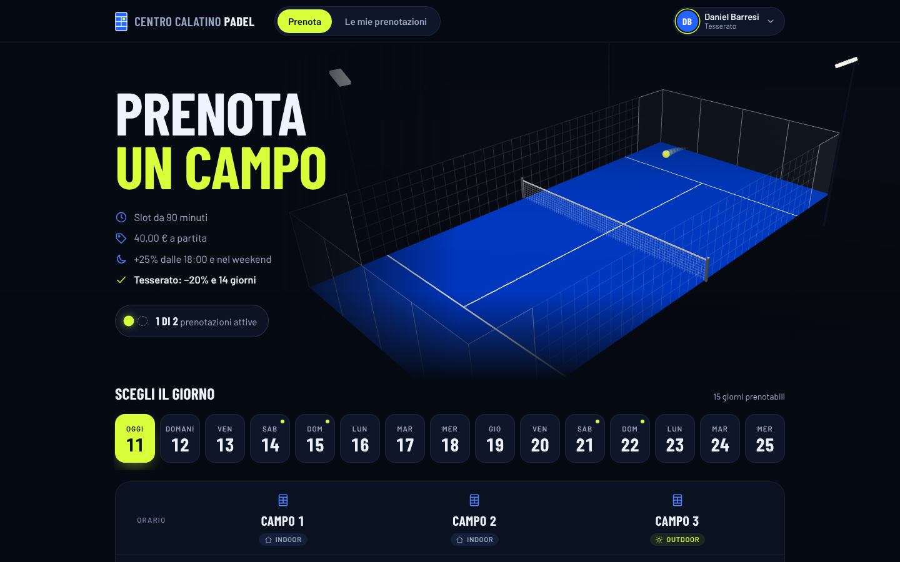
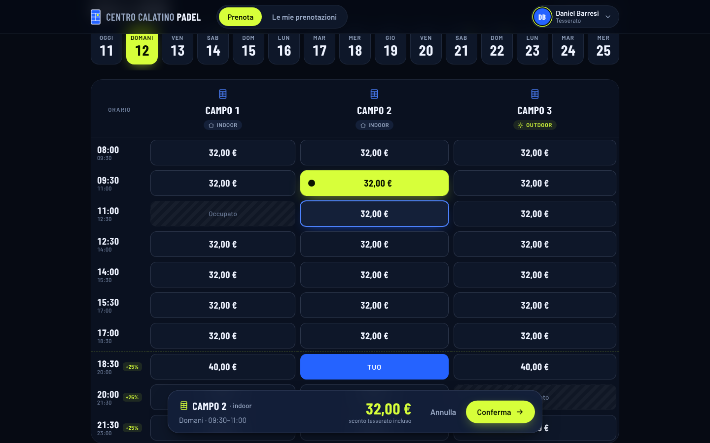
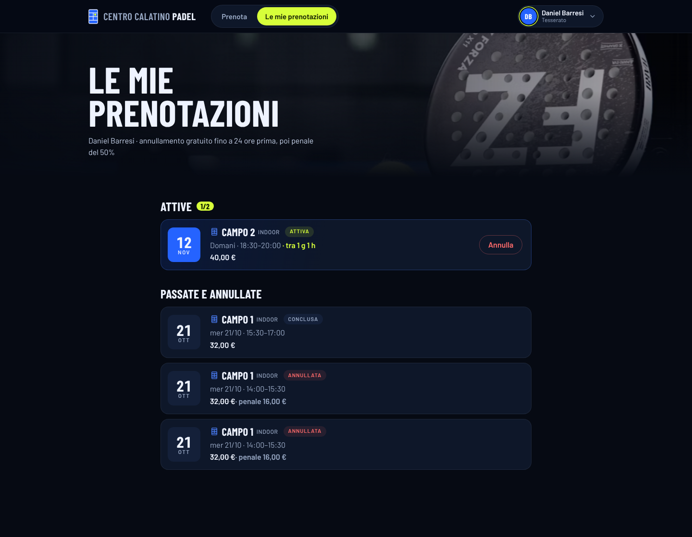
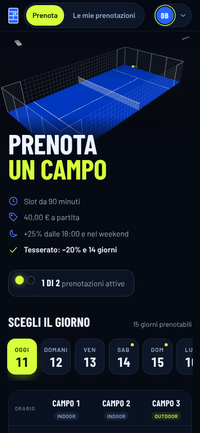
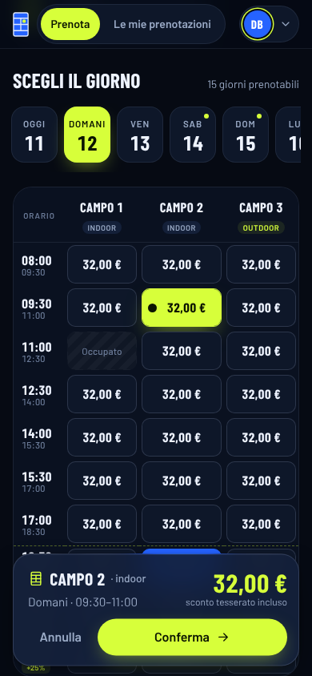

# Centro Calatino Padel – Prenotazione campi


Web app con cui i soci prenotano i campi da padel del circolo.
Candidato: **Daniel Barresi** – Corso 32 Web and Mobile Development, ITS Steve Jobs Academy.

## Tecnologie
| Parte | Tecnologie |
|---|---|
| Frontend (`frontend/`) | React 18, TypeScript, Vite, React Router |
| Backend (`backend/`) | Node.js, Express, TypeScript (eseguito con `tsx`) |
| Database | file JSON (`backend/data/db.json`) con scrittura atomica |
| Test | `node:test` sulle regole di prenotazione |

## Avvio
```bash
npm install     # installa anche backend e frontend
npm run dev     # API su http://localhost:3001 + app su http://localhost:5173
npm test        # test delle regole
```

## Versione 3D animata (`frontend-3d/`)
Grafica rifatta da zero (campo da padel in 3D con Three.js, animazioni con Motion) sullo **stesso backend e le stesse API**: la versione d'esame in `frontend/` resta invariata. Dettagli in `frontend-3d/LEGGIMI-3D.md`.

```bash
npm install --prefix frontend-3d
npx concurrently "npm run dev --prefix backend" "npm run dev --prefix frontend-3d"
```

## Screenshot

| Versione 3D – Prenota | Versione 3D – slot scelto e riepilogo |
|---|---|
|  |  |

| Le mie prenotazioni | Mobile – Prenota | Mobile – griglia |
|---|---|---|
|  |  |  |

Versione d'esame (`frontend/`): [desktop](docs/screenshots/esame-prenota-desktop.png) · [mobile](docs/screenshots/esame-prenota-mobile.png)

<sub>Catture dell'11/11/2026 con Chrome headless sull'app in locale, senza ritocchi; dati di prova (3 prenotazioni demo).</sub>

## Architettura
- **Backend**: `index.ts` (avvio e gestione errori) → `routes/api.ts` (rotte) → `services/` (regole) → `repository.ts` (unico modulo che legge e scrive i dati).
- **Frontend**: i componenti non chiamano mai `fetch`: tutte le letture e i salvataggi passano da `src/api.ts`.
- Prezzi, disponibilità e limiti sono calcolati e verificati **sul server**.
- Le regole della traccia (orari, prezzi, limiti) stanno tutte in `backend/src/config.ts`.

## Requisiti
| # | Requisito | Dove |
|---|---|---|
| 1 | Selezione utente da lista | `Header.tsx`, `AppContext.tsx` |
| 2 | Griglia campi × giorni, slot da 90' dalle 8:00 alle 23:00 | `slots.ts` (`slotTimes`, `bookableDays`), `GET /api/grid`, `Booking.tsx` |
| 3 | Niente slot occupati, iniziati o passati | `createBooking` in `bookings.ts` (409) |
| 4 | Prenotazioni persistenti | `repository.ts` → `data/db.json` |
| 5 | 40 €, +25% dalle 18:00 o nel weekend (non cumulabili) | `priceFor` in `slots.ts` |
| 6 | Massimo 2 prenotazioni attive | `isActive` + `createBooking` |
| 7 | Le mie prenotazioni, annullamento con penale 50% sotto le 24 h | `MyBookings.tsx`, `cancellationPenalty`, `cancelBooking` |
| 8 | Tesserati: −20% e 14 giorni | `priceFor`, `bookableDays` |

## API
| Metodo | Percorso | Descrizione |
|---|---|---|
| GET | `/api/config` | campi, utenti, regole, orari |
| GET | `/api/days?userId=` | giorni prenotabili |
| GET | `/api/grid?userId=&date=` | disponibilità e prezzi del giorno |
| GET | `/api/bookings?userId=` | prenotazioni dell'utente |
| GET | `/api/bookings/:id/penalty` | anteprima penale |
| POST | `/api/bookings` | nuova prenotazione |
| POST | `/api/bookings/:id/cancel` | annullamento |
| POST | `/api/reset` | azzera i dati (demo) |
